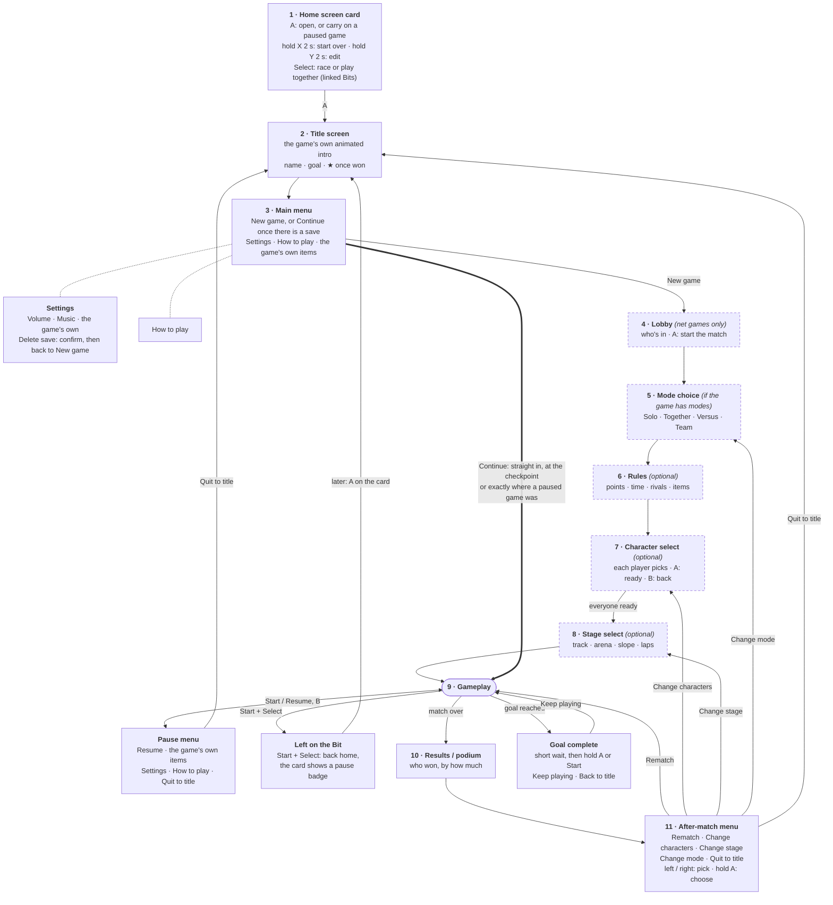
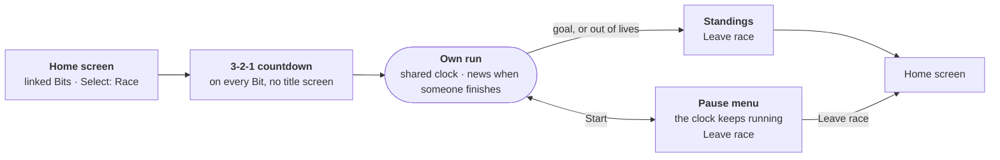

# BitKit game rules

Every BitKit game has the same five things, whether it ships with BitKit or comes from the community. They make any game on a PocketBit feel finished: you can pick it up, see what to do, play it to an end, put it down and come straight back.

| # | Rule | In short |
|---|---|---|
| 1 | **Main menu** | A title screen with New game (Continue once there is a save file) and Settings. |
| 2 | **One playable level, start to end** | At least one level you can play from the start to a finish. |
| 3 | **Quick resume** | Continue puts you straight back into play, or at your last checkpoint. |
| 4 | **Pause menu with settings** | Start pauses. The pause menu has Resume, Settings (at least the volume) and Quit to title. |
| 5 | **A clear goal** | One sentence on the title screen tells you what you're trying to do. |

You don't have to build any of this yourself. One call to `game{}` in `_init` gives your game the title screen, the pause menu, the settings, checkpoints and the "goal complete" screen, with the same look and buttons as every other BitKit game. The studio's **Checklist** button (and its Game tab) checks your game against the list.

## How a game flows

Every game goes through the same screens in the same order, so a player who knows one BitKit game knows them all. It's the order big party and racing games use too: the mode and its rules first, then everyone picks a character, then the stage, then play, and after the match a menu to go again or change something. Steps with a dashed border are optional: skip the ones your game has no use for, but keep the order of the rest.



| Step | What happens | Who does it |
|---|---|---|
| 1. Home screen card | **A** opens the game, or carries on a paused one. **Hold X** for 2 seconds starts it over, **hold Y** for 2 seconds opens it in the editor (a bar fills while you hold). With linked Bits, **Select** switches between playing together and racing. | The Bit |
| 2. Title screen | The game's own animated intro (`title_draw`), its name, its goal, and a star once it has been won. A paused game picked again comes back here too, so the intro still plays. | `game{}` |
| 3. Main menu | **New game** the first time, **Continue** once there is a save file (never both), then your own items (`menu`, like Levels), **Settings** and **How to play**. Settings has **Delete save**, which asks first and brings back New game. | `game{}` |
| 4. Lobby | Only for net games (10 to 20 Bits, like Sweep Storm): who's in, and A starts the match. Lockstep games don't need one: Bits link up on the home screen before the game starts. | your game |
| 5. Mode choice | Only for games with more than one way to play: Solo, Together, Versus, Team. Call the screen "Pick a mode". | your game |
| 6. Rules | The match's rules: points to win, time limit, rivals, items. Keep it to one screen. | your game |
| 7. Character select | Each player picks their look (rider, kart, boat, colour) at the same time and presses **A** when ready; **B** takes it back, or goes back a step. | your game |
| 8. Stage select | Where to play: the track, arena or slope (and how many laps). Player 1 picks. | your game |
| 9. Gameplay | **Start** opens the pause menu (Resume, your `pause` items, Settings, How to play, Quit to title). **Start + Select** leaves for the home screen and keeps the game exactly as it was. | `game{}` + your game |
| 10. Results / podium | Who won and by how much. | your game |
| 11. After-match menu | `game_over{...}`: a row along the bottom with **Rematch** and whatever can change (**Change characters**, **Change track**, **Change mode**), then **Quit to title**. Left / right picks, **A has to be held** to choose, so buttons still mashed from the match can't skip it. | `game{}` + your game |
| Goal complete | `game_win()` reached the goal. A short wait, then hold A or press Start: Keep playing, or Back to title. | `game{}` |

Continue (thick arrow) never goes through steps 4 to 8: it goes straight back into play, at the last checkpoint, or exactly where the player left a paused game.

Your own setup screens (steps 4 to 8) aren't the match yet, so Start shouldn't pause there. Tell the shell when they're up with `in_menu`:

```lua
game{
  title = "Snowbelly",
  in_menu = function() return state == "yard" or state == "pick" end,   -- rider pick, slope pick
}

-- and when the match is over (once, after the results have had a moment):
if state == "podium" and state_t > 90 and GAME.state == "play" then
  game_over({
    { "Ride again", function() start_run(course_n) end },
    { "Change slope", function() state = "pick" end },
    { "Change rider", function() state = "yard" end },
  })
end
```

**Racing a one-player game** skips the title screen altogether: every Bit counts down together and plays its own run on a shared clock.



## The smallest game that meets the rules

This is what **New** in the studio starts you with:

```lua
function _init()
  game{
    title = "my game",
    goal = "Catch 10 stars.",
    help = {"D-pad: move. A: beep."},
    continue = function(cp) score = cp.score end,   -- Continue on the title screen
  }
  x, y, score = 152, 112, 0
  new_star()
end

function new_star() sx, sy = rnd(16, 296), rnd(32, 216) end

function _update()
  if btn("left") then x = x - 2 end
  if btn("right") then x = x + 2 end
  if btn("up") then y = y - 2 end
  if btn("down") then y = y + 2 end
  if math.abs(x + 8 - sx) < 12 and math.abs(y + 8 - sy) < 12 then
    score = score + 1
    new_star()
    checkpoint({score = score})         -- remember the progress for Continue
    if score == 10 then game_win("You caught all 10 stars!") end
  end
end

function _draw()
  cls(1)
  circfill(sx, sy, 4, 27)
  rectfill(x, y, 16, 16, 17)
  text("stars " .. score .. "/10", 8, 8, 13)
end
```

## The rules in detail

### 1. Main menu

The game opens on a title screen, not in the middle of the action. It shows the game's name and goal and offers:

- **New game** the very first time, or **Continue** once the game has a save file (see below). Never both.
  Games of matches with no progress to keep (Sweep Storm: a lobby, then a match) pass `matches = true` instead: the title always has **Play**, which starts afresh at the lobby, and **Continue** above it only while there is a match to go back to.
- **Settings**, with **Delete save** when there is a save file.
- **How to play**, if you pass `help`.

`game{title = "...", goal = "..."}` draws all of it over your game's first frame, so the title screen looks like your game with no extra art.

### Your own title screen

Every game deserves a title screen of its own. Give `game{}` a `title_draw` function and the shell calls it every frame on the title screen, instead of your `_draw`, and puts the name, the goal and the menu on top. `t` counts the frames since the title screen opened, so anything can move:

```lua
function draw_title(t)
  cls(19)
  for i = 0, 30 do pset((i * 73) % 320, (i * 37 + t // 2) % 240, 13) end   -- falling snow
  spr(1, 150, 150 + math.sin(t / 20) * 6, 2, 2)                            -- your hero, bobbing
end

function _init()
  game{
    title = "Snowfall",
    goal = "Find the lost mitten.",
    title_draw = draw_title,
    look = {title = 23, shadow = 1, panel = 19, edge = 22, text = 13, pick = 27, menu = "right"},
  }
end
```

- The art keeps moving behind Settings and How to play opened from the title, a little darker so the menu stays readable.
- Draw in screen space: the camera and `clip()` are reset before `title_draw`. Shaders work as usual (`wave()`, `ripple()`, `tint()`...).
- Don't change the game in `title_draw`: it only draws. If you borrow drawing functions that read a game timer, set the timer to `t` and put it back after (Crossgate and Tinwing do).
- `look` gives every menu of your game (title, pause, settings, goal complete) your colours, and moves things around on the title screen:

| `look` field | What it sets | Default |
|---|---|---|
| `title`, `shadow` | Colour of the game's name and its shadow (`shadow = false`: no shadow) | 27, 1 |
| `panel`, `edge` | Menu box fill and border (`false`: none) | 1, 13 |
| `text`, `pick`, `hi` | Menu text, the picked item, and the bar behind it | 13, 27, 2 |
| `goal`, `footer` | The goal line and the hint at the bottom | 17 / `text`, 29 |
| `name_y`, `scale` | Where the name sits and how big (1-4). `name_y = false` hides it, for a logo you draw yourself | 30, by length |
| `goal_y` | Top of the goal box | under the name |
| `menu`, `menu_y` | `"center"`, `"left"` or `"right"`, and the top of the title menu | `"center"`, above the footer |

Every built-in game has its own: Sprout Hop hops through a scrolling meadow and grows saplings into trees, Beacon Keeper's beam turns and lights up ships, Sweep Storm digs its island while the storm closes in, Kart Lab races into the sunset, Wren and Rook trade bolts in Crossgate, your own plane circles the sea in Tinwing, and Deepglow's sonar finds pearls in the dark.

### 2. One playable level, start to end

There is at least one level that a player can finish: from New game, through the level, to an ending. "Endless" games (idle games, high-score chasers) still need a goal you can reach, like "guide 100 ships home"; the game can carry on afterwards.

When the player reaches the goal, call `game_win("what they did")`. It shows the **Goal complete** screen (after any cutscene that is playing ends), lets them keep playing or go back to the title, and puts a star on the title screen from then on. Buttons still mashed from play can't skip it: it waits a moment, then **A has to be held** (a bar fills) or **Start** pressed.

**When a match ends**, show your results, then call `game_over({...})` for the after-match menu (see How a game flows): it has the same protection. For a screen in between, like the next run of a cup, use `hold_btn("a")` instead of `btnp("a")`. It is true once, when A has been held for 45 frames, the shell draws the filling bar for you, and the held A doesn't count as a press on the next screen. Say "hold A: next" on screen.

### 3. Quick resume

Picking the game up again takes one button press. Two things make that happen:

- **Pausing on the Bit.** Leaving a game with Start+Select (or the home screen) keeps it exactly where it was. Picking it again on the home screen opens the game's main menu (its title screen and intro still play), and **Continue** carries on mid-jump. Games made with `game{}` do this on the Bit and in the studio; you don't need any code. (A race keeps running, and X on the home screen still starts a game over.)
- **Continue from a checkpoint.** After a reload or a restart, Continue on the title screen goes straight back into play: call `checkpoint({...})` whenever the player reaches a safe spot (a new level, a checkpoint flag, a finished race), and give `game{}` a `continue = function(cp) ... end` that puts the player back there. Games that already keep their own `save()` pass `can_continue = function() return saved() ~= nil end` instead, plus `new_game` to reset the game.

Continue never goes through extra screens: no "press start", no level select, no garage. Straight into the game.

### Save files

Every game has a save file, kept by the shell. The first time the player starts playing (New game, or a level picked from a level select), the save file is made, and from then on the title screen shows **Continue** instead of **New game**. Continue goes back to the last checkpoint, or to the start of the game if the player never reached one.

To start over, the player opens **Settings** (from the title or the pause menu) and picks **Delete save**. It asks first ("Delete your save? Your progress in this game is gone for good."), then wipes the checkpoint, the goal star and everything the game keeps with `save()`, and goes back to the title screen with **New game**. Volume and the game's own settings stay. If the game was already running, the Bit loads it again so nothing from the old save is left in memory.

You don't need any code for this. Runs started from an editor (▶ play level, ▶ race it) don't make a save file, and linked Bits ignore it (see Multiplayer).

### 4. Pause menu with settings

**Start** pauses the game (Start+Select still goes to the home screen, and Start still skips a cutscene). The pause menu has:

- **Resume** (B does the same).
- Anything game-specific you add with `pause = {{"Restart race", restart}}`.
- **Settings**: **Volume** always (it scales every `sfx()` and `tone()`), **Music** if you pass `music = true` and play music with `mus()`, and your own settings from `settings = {...}`. Read them with `setting("key")`. They are saved with the game.
- **How to play**, if you pass `help`.
- **Quit to title**.

Because Start belongs to the pause menu, don't use it for anything else in your game.

### 5. A clear goal

One sentence, shown on the title screen and in How to play, that says what winning means: "Reach the red flag at the end of Mossy Cave", "Finish 1st on every track". Show progress towards it while playing when you can (drops 3/10, ships home 37/100, wins 1/2).

### Speaking the Bit's language (recommended)

The Bit's language is picked in the Settings app (LANGUAGE: English, Deutsch, Français, Español). The shell (title, pause menu, settings, How to play, races) already follows it, and so do common setting values (Easy, Normal, Hard, On, Off). Your game adds its own words with `texts{}`, usually at the end of the code:

```lua
texts{
  de = { ["SCORE #"] = "PUNKTE #", ["You found %s!"] = "Du hast %s gefunden!", ["Reach the flag"] = "Erreiche die Flagge" },
  fr = { ["SCORE #"] = "SCORE #" },
}
```

- `text()` translates by itself: `text("SCORE " .. score, ...)` finds `"SCORE #"` (numbers stand in as `#`) and draws `PUNKTE 120`. A line centred on the screen, or sitting at its right edge, stays centred or right-aligned when it gets longer.
- For words you put together or wrap into lines yourself, translate first: `tr("You found %s!", tr(item))`, `tr{en = "Start", de = "Los"}`. `textw(s)` gives the width in pixels, `lang()` the language code, `lang_nth(n)` an ordinal (1st, 1., 1er, 1º).
- `title`, `goal`, `help`, setting names and values in `game{}` go through `tr()` in the shell, so list them in `texts{}` as written.
- Words with no translation stay in English, so a game is never broken by a missing word. `texts(false)` turns the automatic `text()` translation off.
- The font draws ä ö ü ß é è ê à ç ñ ¿ ¡ € and more (Windows-1252). Write them straight into your code as UTF-8.
- German runs about a third longer than English. Leave room, or shorten the German.

## Multiplayer

### How many can play

Say how many players your game takes in `game{}`, as a plain number or `{min, max}`:

```lua
game{ title = "Kart Lab", players = {1, 8}, ... }
game{ title = "Tinwing", players = 1, ... }
```

The home screen and the studio's Games menu show it on every game (`1 player`, `1-4 players`), and linked Bits use it: a game started on a Bit while other Bits are on their home screens starts on as many of them as it takes (Sprout Hop, 1-2 players, on 3 Bits: 2 play, the third stays home), and a one-player game plays on that Bit alone. Without `players = ...` a game is one-player, unless its code uses `PLAYERS` (then 1-8). The host reads the field from your code before the game runs, so write plain numbers there, not expressions.

### Racing a one-player game

A one-player game can still be played with friends: add `race = "time"` (or `"score"`) and, started on linked Bits, it starts on every Bit at the same moment, each player in their own run. The shell does the rest: a 3-2-1 countdown, a clock in the corner, a line at the top when someone finishes, and the standings when you finish. A race run never touches the save file; the pause menu and the standings have **Leave race**.

- `race = "time"`: the fastest to `game_win()` wins. Sprout Hop, Deepglow and Tinwing race this way.
- `race = "score"`: call `race_score(n)` with the run's score as it goes; the run ends at `game_win()` or `race_end()` (out of lives, out of time), and the highest score wins.

While racing, `RACE` is `{kind, n, seat, names}` (your seat and how many race) and `GAME.race` holds the standings; `race_score()` and `race_end()` do nothing outside a race. A game with both `players = {1, 2}` and a race plays together by default; **Select** on the home screen switches it to a race (for more Bits than it takes, say). The Bits tell each other how their runs go with network events (reserved event `-7701`), so a race works with any number of Bits in reach, on PocketBits as in the studio.

### Lockstep

Linked Bits run the same game in lockstep, so the shell keeps every Bit identical: menus are driven by the players' buttons only, saved checkpoints, save files and game settings are ignored while linked (volume still applies on each Bit), and Continue, Delete save and Quit to title are hidden. Your game should do the same: when `ME > 0`, don't let one Bit's save change the game.

Games for more Bits than lockstep can carry (10 to 20) use network events instead (`net_send`, `net_recv`, `NET_ID`; see the studio's Help tab). Those Bits aren't kept identical, so the shell treats them like single-player games: each Bit has its own menus, and the pause menu doesn't stop the match for the others. Sweep Storm is the example.

## `game{}` reference

```lua
game{
  title = "Sprout Hop",                        -- name on the title screen
  goal  = "Reach the red flag.",               -- one sentence
  help  = {"D-pad: move", "A: jump"},          -- How to play page (optional)
  continue = function(cp) ... end,             -- put the player back at checkpoint cp
  can_continue = function() return ... end,    -- Continue for games that keep their own save (optional)
  new_game = function() ... end,               -- reset such a game (optional)
  pause = {{"Back to checkpoint", fn}},        -- extra pause menu items (optional)
  menu = {{"Levels", fn}},                     -- extra title screen items, after New game / Continue (optional)
  players = {1, 4},                            -- how many can play: a number or {min, max} (default 1)
  race = "time",                               -- linked Bits race a one-player game: "time" or "score" (optional)
  settings = {                                 -- extra settings (optional)
    {key = "laps", name = "Laps", min = 1, max = 5, value = 3},
    {key = "ai", name = "Rivals", values = {"Easy", "Normal", "Hard"}, value = 2},
  },
  music = true,                                -- adds the Music level, for notes played with mus()
  title_draw = function(t) ... end,            -- your own animated title screen (optional, see above)
  look = {title = 27, panel = 1, menu = "right"},   -- your menus' colours and layout (optional)
  in_menu = function() return state == "pick" end, -- true while your own setup screens are up: Start doesn't pause (optional)
  matches = true,                                  -- a game of matches with a lobby: the title has Play, and Continue only back into a match (optional)
}
```

| Call | What it does |
|---|---|
| `checkpoint(t)` | Remember where to carry on. `t` is any table `save()` can store. `checkpoint(nil)` forgets it. |
| `game_win(text)` | The goal is reached: the Goal complete screen, and a star on the title. |
| `game_over(items)` | The match is over: the after-match menu along the bottom of the screen, `items = {{"Rematch", fn}, {"Change track", fn}, ...}`. The shell adds Quit to title (not when linked), waits a moment, and wants A held to choose. Your `_update` and `_draw` keep running under it, so a podium can animate. |
| `hold_btn(b, n)` | True once, when button `b` has been held `n` frames (default 45) by any player: for results screens, so a stray press can't skip them. The shell draws a filling bar while it's held. |
| `setting(key)` | A settings value. `"volume"` and `"music"` are 0 to 10. |
| `mus(note, ...)` | Same as `sfx()`, but also follows the Music level. |
| `game_play()` | Skip the menus and go straight into play (for example when a level is started from the editor). |
| `game_screen()` | Hand the screen to your own menu, like a level select: `_update` and `_draw` run, the shell draws nothing and Start does nothing. It isn't gameplay yet, so Continue on the title still works. Leave with `game_play()` or `game_title()`. |
| `game_title()` | Back to the title screen. |
| `GAME.state` | `"title"`, `"play"`, `"screen"`, `"pause"`, `"settings"`, `"help"`, `"confirm"`, `"won"` or `"over"` (the after-match menu). |
| `GAME.items` | The names in the menu on screen, top to bottom (handy for tests). |

Sprout Hop shows how the pieces fit together for a level select: **Levels** on the title (`menu`) and in the pause menu (`pause`) opens a `game_screen()` that lists the levels you have reached with your stats for each (kept with `save()`), and starting one calls `game_play()`. Continue still skips it and goes straight back to the checkpoint.

The checkpoint and settings are stored in the game's save next to (not inside) what you keep with `save()`, so `save()` and `saved()` keep working as before.

The studio skips the title screen when you start a level, a cutscene or a track from an editor (▶ play level, ▶ race it). **Run** shows the title screen, like the Bit does.

The shell lives in [`runtime/bk_game.lua`](runtime/bk_game.lua), part of the runtime on both the web and the PocketBit.
