<div align="center">

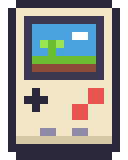

# BitKit

**Make tiny games in your browser. Play them on a handheld you built yourself.**

The game runtime and browser studio for **PocketBit**, a DIY ESP32-S3 handheld.

[](https://github.com/Dvrkstvr/bitkit/actions/workflows/ci.yml)
[](https://github.com/Dvrkstvr/bitkit/actions/workflows/pages.yml)
[](LICENSE)


[](CONTRIBUTING.md)

### [▶ Open the studio](https://dvrkstvr.github.io/bitkit/) · [🎮 Share website](https://dvrkstvr.github.io/bitkit/hub.html) · [Offline version](dist/bitkit-studio.html) · [Hardware repo](https://github.com/Dvrkstvr/pocketbit)


</div>

---

## ✨ Why BitKit?

- 🎮 **Plug in a controller and play.** Press Run and you're testing with a real gamepad straight away. Analog triggers come through as `press()` from 0 to 255.
- 🧠 **One runtime, two homes.** The same C code runs on PocketBit and, compiled to WebAssembly, in your browser. What you test is what ships.
- 👾 **Enemies without code.** Build entities with sprites, animations, stats and a visual behavior tree, then paint them onto the map.
- ⚡ **Fast to change.** Edit code, art or a level, press Run, and see the change right away. Everything autosaves.
- 🔓 **Open all the way down.** MIT software and open hardware. No accounts and no installs.

## 🖼️ The studio


**Edit** and **Play** at the top switch between making a game and playing it on a Bit, the emulated PocketBit. Play can show two linked Bits side by side, each with its own controls, to try a game for two. **Games** has the demos and your own games, and each one keeps its own changes.

| Tab | What it does |
|---|---|
| **Game** | Sliders, switches and lists for every number a game declares with `tune()`, the player's hearts and stats, and the game checklist |
| **Code** | Lua editor with syntax highlighting, completion with a line of help for every function, find (Ctrl+F), error-line markers and a console |
| **Sprites** | 512 tiles of 8×8 pixels; pen, fill, pick, flip, rotate and tile behaviours (named chips: switch on `solid`, `water`… and ask `fget(tile, "water")`); a 256-colour palette editor |
| **Map** | 256×128 tile map with Tiles and Entities layers, paint, eraser, box and fill tools, zoom with the wheel. A ghost of your last 3 play routes shows where the player actually goes |
| **Track** | For racing games: spline road editor, items along the lap, elevation brush and the road's segment tiles |
| **Entities** | Sprites, animations, team, HP, stats, effects (heal, slow…) and a behavior tree with presets, where every step says what it does |
| **Cutscenes** | Dialog with portraits, camera pans, walks, fades and screen shake. Play them when a level starts, from a trigger zone on the map, or from code |
| **Controller** | Live view of every button, remapping, threshold and deadzone |
| **Help** | Getting started, and the full API reference with search |

Tabs a game does not use (Track for a platformer, Map for a racer) wait under **More**. Undo and redo work on every tab.

<details>
<summary>📸 More screenshots</summary>


</details>

## 🚀 Quick start

1. Open **[dvrkstvr.github.io/bitkit](https://dvrkstvr.github.io/bitkit/)** in Chrome, Edge or Firefox.
2. Press **▶ Run** (or Ctrl+Enter) to play the game that is open, Sprout Hop at first. Click the game screen and use the arrow keys with Z and X, or plug in a controller and press any button on it.
3. **Games** at the top has every demo (Sprout Hop, Beacon Keeper, Sweep Storm, Kart Lab, Crossgate, Tinwing, Deepglow, Puffball, Hedge Hogs, Cauldron Crew) and your own games. Each one keeps its own changes.
4. Change something and press Run again. The **Game** tab has sliders for how the game feels, the other tabs are the editors.
5. **Play** at the top shows the game on a Bit, the emulated PocketBit, with its home screen. Pick **2 Bits side by side** to try playing together. Hold Start+Select to go back to the home screen.

Want it offline? [`dist/bitkit-studio.html`](dist/bitkit-studio.html) is one self-contained file.

A cart is just three functions:

```lua
function _init()   x, y = 160, 120 end
function _update()
  if btn("left")  then x = x - 1 end
  if btn("right") then x = x + 1 end
end
function _draw()   cls(1) circfill(x, y, 4 + press("r") / 32, 9) end
```

## 📏 Game rules

Every BitKit game, built-in or from the community, has a **main menu**, **one level you can play from start to end**, **quick resume** (a save file from the first play, so Continue goes straight back into play or to your checkpoint; Delete save in Settings starts over), a **pause menu with settings** such as the volume, and **a clear goal**. One call gives your game all the menus:

```lua
function _init()
  game{title = "my game", goal = "Catch 10 stars.", continue = function(cp) score = cp.score end}
  -- ... call checkpoint({score = score}) as you go, and game_win("You did it!") at the end
end
```

The studio's **Checklist** button checks your game. Read the details in **[GAME_RULES.md](GAME_RULES.md)**.

## 🌱 The demos

Open **Games** in the studio to pick one.

### Sprout Hop

A small platformer that shows off most of the engine:

- Analog run on **R** and pebbles on **B**. Stomp slugs and bees.
- Water drops heal you. Mud and sticky seeds slow you down.
- Stand next to a **sapling** while it grows and fight off the bees it attracts. Once it's a tree, it's your checkpoint.
- Talking NPCs, and a pressure button that opens a gate.
- Two levels, with cutscenes when each one starts and when you reach the gate.
- **Goal:** reach the red flag at the end of Mossy Cave. Continue picks up at your last tree.
- Two players: pick **2 players** under the screen (player 2 is the blue sprout), or press **＋ Add a Bit** to play from several linked windows (up to 8 players).

### Windrow (the farming game)

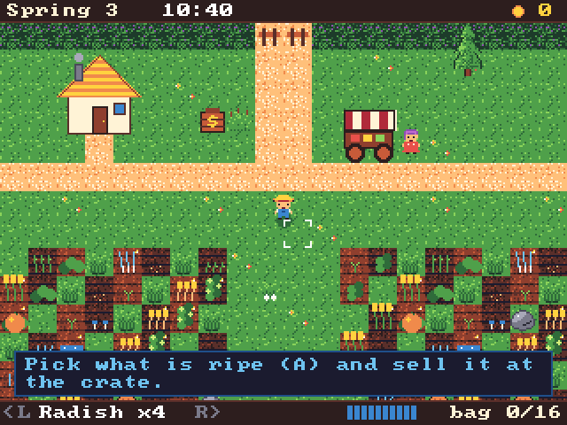 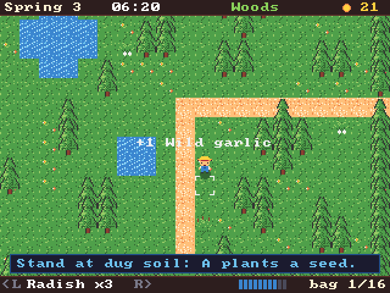
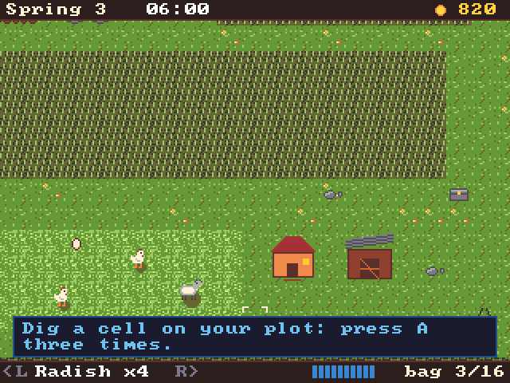
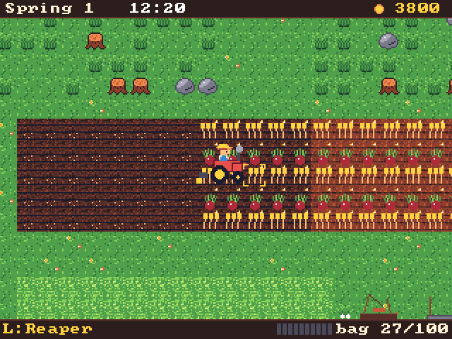 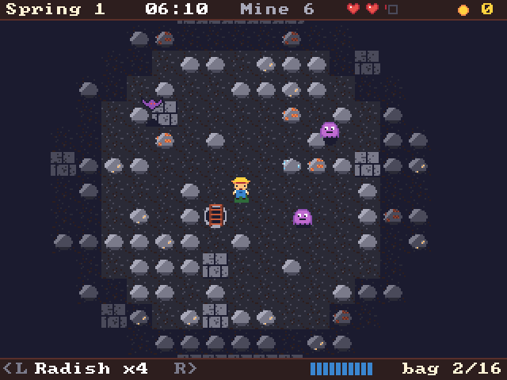

BitKit's flagship game, and it is growing. You arrive in the valley of Windrow with a digging stick, a leaky bucket and four radish seeds. So far it has the farm, the hand work, the woods, the animals, the old mine and the tractor.

- **Hand work.** Your plot is overgrown. **A** uses your hands on what is in front of you: pull weeds (fibre), dig a cell (three goes with the stick), plant the seed you picked with **L / R**, and pick what is ripe. **B** waters, and the bucket holds five splashes before you walk back to the pond. **X** opens your bag and **Y** looks closer.
- **Days and seasons.** Watered crops grow overnight. A day lasts five minutes, a season seven days, and each of the four seasons has its own crops: radishes, barley and sweet peas in spring, tomatoes, corn and sunmelons in summer, pumpkins in autumn, snowleeks and frostcaps in winter. Rain and snow water the fields for you.
- **Foraging.** The road west leads to Bramble Woods, where new things turn up every morning: wild garlic, brambleberries, pennybuns or pine cones to sell, and sticks, pebbles and reeds to build with. That is how you earn your first coins.
- **Marrow's wagon** sells the season's seeds, a hoe, watering cans, a bigger basket, a pickaxe and an axe for the stones and stumps on your land, and the deeds to the East meadow and the Long acre. Every day she pays extra for one crop.
- **Animals.** South of the fields lies the pasture. Mend the hen house and the goat shed with wood, fibre, stone and a few coins, and Marrow brings hens and goats. Fill the trough from your bag (each animal eats a helping a night), gather the eggs by hand, and milk the goats into a pail. A pat a day wins their hearts: loved hens lay big eggs and loved goats give creamy milk. Hungry animals lose heart.
- **The old mine.** The boarded-up mine in the woods opens with a pickaxe. It has ten floors, new every day, and your lamp only reaches so far. Break rocks for stone, copper, iron and glowstone, and find the ladder hidden under one of them. From floor 4 down, gloomlings and bats live in the dark: **A** hits them with the pickaxe, each bite costs one of your three hearts, and if you run out you wake at home with half your ore. The winch takes you back to floor 5 or 9 once you have been there, a lantern from Marrow lights more, and the chest on floor 10 holds the millstone the windmill needs.
- **The tractor (mid game).** A rusted tractor stands by the Long acre. Mend it with iron and copper from the mine, and Marrow sells implements for it: a plough, a seed drill, a water tank and a reaper. **A** climbs on, holding **A** works the cell under you and the one on either side as you drive, **L** changes the implement, **R** the seed, **B** fills the tank at the pond (or honks), and **Y** hops off.
- **While the Bit is off**, the farm carries on (`save()`, `saved()` and `clock()`): up to three days pass, and what you watered keeps growing.
- **Goal:** rebuild the old windmill in three steps, with wood, stone, fibre, coins, crops for the builders and the lost millstone. With the sails up, grain sells for double.
- **Very late: the tractor drives itself.** Once the mill turns, build the silo and buy the clockwork driver
  from Marrow. Press Y beside the tractor and teach it a route by driving it once, working as you go. It
  then drives that route by itself, every morning if you like (also on days that pass while the Bit is
  off), unloads what it reaps at the silo as it passes, and fills its tank at the pond. The silo sells at
  the day's prices and tops up an empty trough.

  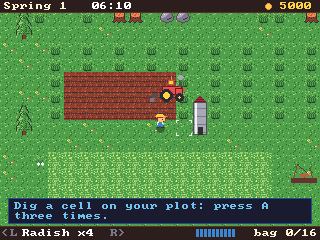
- **Neighbours.** Every Bit keeps its own farm, and Bits in reach are neighbours (in the studio: open
  Windrow in two windows). The north road lists them; pick one and you walk over to their farm as it
  really is, in their season and weather. There you can water their crops, see each other walk about,
  and leave gifts at their crate. Every farm has a wish a day: bring that crop and the valley pays you
  well. Everything the farms in reach reap fills one fair basket, and when it is full every farm gets
  150 coins and watered fields. It all runs on network events, so it works between PocketBits over
  ESP-NOW and survives lost packets.

  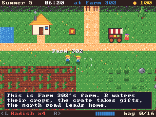

### Beacon Keeper


An idle game for 1 to 4 players. Player 1 is the lighthouse in the middle of a sea bigger than the screen. Everything is drawn from code, without a map or entities.

- Ships can't see the rocks. Aim your beam at them and they steer around the rocks into the harbour.
- Squeeze **R** for a brighter beam that burns lamp oil. Squeeze **L** for a narrow, long spotlight. **B** sounds the foghorn.
- Each day brings a sea haze that hides the rocks and shortens the beam. At night, pirates hunt the merchant ships, so keep your light on them until they flee.
- Docked ships pay tolls. Spend them in the harbour shop (**X**) on oil, a better lens, ship lanterns, coast cannons, a bigger harbour, and a clockwork lens that aims the beam for you.
- Players 2 to 4 row little boats (player 1 can hop into one with **Y**). They pick up the crates floating in the water, including the ones wrecks and sunk pirates drop, and bring them to the island. If a boat hits a rock, it spills its cargo.
- With one player it uses `save()`, `saved()` and `clock()`, so the harbour keeps earning while the Bit is off.
- **Goal:** guide 100 ships safely home (the harbour keeps going after that).

### Sweep Storm


A minesweeper battle royale for up to 20 Bits, with bots filling the empty spots.

- One big round island, made from a seed the Bits share, so every match is a new map. Everyone digs at the same time.
- The shore is easy and worth 1 point a cell. The middle ring has more mines and is worth 2; the core is packed with mines and worth 4.
- Power-ups hide under the cells and get stronger towards the middle: Shield and Scan on the shore, Heart and Sonar in the middle, Blast in the core. Confuse and Paint are tricks you throw at the nearest rival: for a while, everyone but you sees scrambled numbers (Confuse) or no numbers at all (Paint) in that patch.
- Walk over dug ground with the D-pad, **A** digs, **B** flags, **X** uses your power-up and holding **Y** shows the whole island.
- Fog of war: you only see the ground near cells you dug yourself, and you can only walk where you can see (over dug or undug cells). Digging clears fog, and so does standing on dug ground (yours or another player's), so you can follow paths others solved. Undug ground never clears it, so when the storm comes you have to dig or find a path. It can be turned off in Settings.
- A mine costs one of your 3 hearts and stuns you. After 40 seconds a storm closes in from the shore and standing in it costs hearts too.
- **Goal:** have the most points when the storm closes or the time runs out (the last digger standing gets a bonus).
- **Play together:** open more studio windows, load Sweep Storm in each and pick New game (or Continue). They find each other in the lobby and any of them can start. This uses network events (`net_send` / `net_recv`), not lockstep, so it scales to 20 PocketBits over ESP-NOW. Play alone and Continue takes you back to the match.

### Crossgate


A tug-of-war crossbow duel. Wren (orange) fights east out of the Sea Gate, Rook (blue) fights west out of the Mill Gate, through seven rooms of a little town.

- **X** shoots, **A** jumps, hold **down** to crouch. Bolts drop as they fly and nothing blocks them: jump over low ones, crouch under high ones (from far away, a dropping bolt still hits a crouching rival).
- Walk into your rival with a bolt loaded to stab them. If you both walk in loaded at the same height, the bolts clash and push you both back.
- You hold one bolt loaded and one spare. Bolts that miss, or fall from the fallen, lie on the ground: walk over them to pick them up.
- Win a fight and you get the way: run for your gate. Your rival walks back in from the far side of the screen.
- One player fights the Rook (CPU, Easy / Normal / Hard in Settings). Two players share one screen or play on linked Bits. With more players, the winner stays on and the loser goes to the back of the queue.
- **Goal:** get out through your gate before your rival gets out of theirs.

### Tinwing (2.5D)


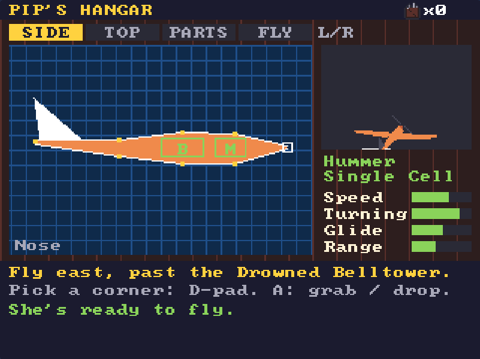
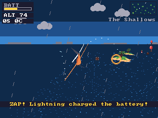

A story game drawn in 2.5D like Kart Lab. Perch is a town on stilts, on a planet that is nearly all sea: letters go by pigeon and people go by boat. You play Pip, who builds radio-controlled planes. You're either in the hangar building, or in the air.

- **Build the plane yourself.** The hangar shows the plane as a blueprint, from the side and from above. Pick a corner with the D-pad, grab it with **A**, move it, and drop it with **A**. The motor (**M**) and battery (**B**) are boxes that have to fit inside the body, and you can grab them too and slide them along it. The motor has to stay in the front half. A bigger motor needs a fatter nose or a spot further back, and the Twin Cell needs a wider body. What you see is what fits: if a box sits inside the outline in both views, it fits. You also shape the wings, which work out how the plane flies: more wing glides further, a short span turns quicker, and a bigger motor is faster but uses more battery. **L / R** (or **X**) switch between the Side, Top, Parts and Fly pages. Parts shows your inventory of motors, batteries, wing cannons, skins and paints. Upgrades come in small steps (five motors, six batteries) and cost materials: scrap from crates, balsa from driftwood on the palm islands, silk from balloons and copper from boxes on the Reef's wrecks. The skin sets the weight: balsa and silk are lighter and glide better, but hawks and storms push them about more. Cannons sit on the wings, one on each side: slide them along the wing on the Top page. Further out they make the plane roll a little slower.
- **Fly.** A chase camera follows you over the sea and the islands (`floorh()`). The plane is the 3D model built from your blueprint and drawn with triangles. Left and right bank, and up and down climb and dive (swap these in Settings). The controls ease in and out on springs, the camera swings round a little late, and there are wingtip trails and speed lines. Hold **A** or squeeze **R** for the motor. Let go and you glide, which costs no battery. Warm air rings give a Tailwind, which is an effect on the Entities tab. With cannons fitted, **B** fires them: pop the balloons for silk, and scare hawks off. To land, fly low over the yellow pad at Perch. If the battery goes flat you splash down, and Tobin fishes you out.
- **The world** is three seas of 256x128 tiles, joined at the edges: fly off one side and you come out in the next. The Shallows has Perch and the Belltower; the Reef to the east has wrecks, copper and hawks' nests; Thunderhead to the north has thunder cells. The first battery barely reaches the Belltower, so you need better ones to see it all. Hawks circle their nests and dive at you: a hit knocks the plane off course. Inside a thunder cell the air is rough, but if lightning hits the plane it charges the battery.
- **The story:** a squall knocked the mail satchel out of the sky past the Drowned Belltower. Your first battery can't get you there and back, but there's a Twin Cell on top of the Belltower. Widen the body to fit it to reach the near Reef, then build a Deep Cell (or find the Storm Cell in Thunderhead) for the far end, where the satchel is.
- **Goal:** find the mail satchel and fly it home to Perch. Continue takes you back to the hangar with your plane and everything you found.

### Deepglow (shaders)

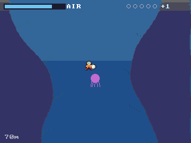 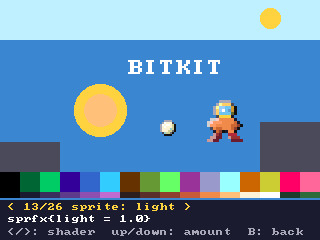

Dive a dark sea cave for glowing pearls. It is a tour of BitKit's shaders: the water wobbles (`wave`), gets darker the deeper you go (`fog`), the sonar ping on **A** spreads as a shockwave (`ripple`) and shows pearls for a few seconds, jellyfish glow through a colour cycle (`remap`) and their sting scrambles the picture (`glitch`), vents shimmer and burn (`tint`), and running out of air fades you out (`pixelate`, `dither`). The diver is a shaded sprite (`sprfx`: lit from above, outlined, flashing when hurt), and pearls are lit by the diver's lamp. **Settings > Screen** picks a look for the whole game (`display`: CRT, Arcade, Old TV, Handheld, Sepia, Night, Vivid). The title screen's **Shader gallery** has every shader with a slider. **Goal:** bring 5 pearls up to the boat.

### Party games: alone, together or against each other

Three games for 1 to 8 players, on one screen or on linked Bits. Each one opens on a game picker: one way to play together and one to play against each other. Alone, the CPU fills in.

#### Puffball

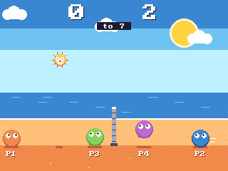

Beach volleyball with a pufferfish. Every touch puffs it up: it gets bigger and faster until somebody misses.

- **Left / right** run, **A** jumps, **B** dives along the sand.
- **Serving:** nobody is frozen after a point. The side that lost it serves: the server carries the puffer above their head, walks to where they want to serve from, and jumps. A moment later the puffer lets go, flying on the way the server was moving. A server who waits 5 seconds serves by itself.
- **Setup and New match:** after picking Match or Rally, everyone picks their own colour (left / right) and the net height (low, normal, high), the puffer (floaty, normal, heavy), its size and the points to win can be set. New match in the pause menu, or A after a match, starts over with the same setup; B after a match goes back to the setup.
- **Match** (against each other): odd players on the left, even players on the right, and crabs fill the empty spots. If the puffer lands on your sand, the other side scores. A side may touch it 3 times in a row. Alone you play a crab (Easy, Normal or Hard in Settings).
- **Rally** (together): everyone keeps the puffer flying, and every pass over the net counts. Three drops end the run.
- **Goal:** win a Match, or pass the puffer 30 times in a row in a Rally.

#### Hedge Hogs

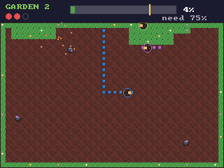

Hedgehogs that plant hedges. Walk off your land and you plant a line behind you. Walk back onto your land and everything you fenced off is yours.

- **Garden** (together): fence off 75% of each of the 3 gardens. Moles dig about in the open ground. A mole that touches an unfinished line eats it and costs the team a heart, and land only fills in if there is no mole in it.
- **Land Grab** (against each other): walk across a rival's unfinished line to send them home. Whatever you fence off is yours, even if it was theirs. Most land when the time runs out wins. CPU hogs fill the garden up to 4.
- The ground is drawn with the map, one tile per cell, so it costs the Bit one `map()` call.
- **Goal:** fence off all 3 gardens, or end a Land Grab with the most land. Continue takes you back to the garden you reached.

#### Cauldron Crew

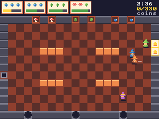

A potion kitchen. The order cards at the top show which three ingredients each customer wants, and how patient they are.

- **A** picks up, puts down or uses what you face, **B** dashes, and holding **X** at a bubbling cauldron stirs it so it brews faster.
- Put 3 ingredients in a cauldron, wait for it to brew, and carry the potion to the window. Leave it on the fire too long and it burns. Burnt and wrong potions go in the bin. Counters hold one thing each, so you can pass things on.
- Fast service tips more, and a streak of right orders adds a bonus. A customer who leaves costs coins.
- **One kitchen** (alone or together): earn the shift's target, which grows with the crew.
- **Teams** (2 players or more): two mirrored kitchens get the same orders at the same moments. Most coins wins.
- **Goal:** earn the shift's target in coins, or out-brew the other kitchen. Continue carries on the shift with your coins and the time left.

#### Mind Laps

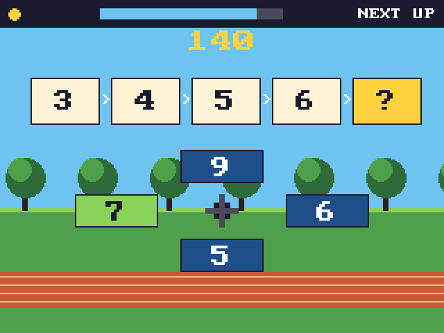

A daily brain jog: five laps of 30 seconds, one quick exercise each. Answers sit on the d-pad, so you press the direction of the right one.

- **Quick Sums** (maths), **Arrow Echo** (memory: watch the arrows, then press them back), **Next Up** (logic: what comes next in the row), **Firefly Jars** (counting at a glance: which jar has more) and **Lanterns** (reaction: A the moment a lantern glows green, never on red).
- **Daily Jog** (alone): the same five laps for everybody on the same day, scored out of 500 with a bronze, silver or gold medal. A jog every day grows your streak of days in a row; the Bit's clock (the PocketBit's RTC) dates it. The last 7 days show as medals.
- **Practice** (alone): one exercise at a time. Every exercise has its own level (1-9) that goes up when you do well and down when you struggle.
- **Race** (2-8 players, one screen or linked Bits): everyone gets the same question, the first right answer scores, a wrong one locks you out of that question.
- **Team** (2-8 players): every right answer counts towards one shared score and medal.
- **Goal:** a gold medal (400 points) on a Daily Jog. Continue takes you back to the next lap of today's jog.

## ✨ Shaders

The Bit has no GPU, so shaders are small C routines that run on the 320x240 picture. Three kinds:

- **Screen shaders**, called in `_draw` after the world and before the HUD, inside `clip()`: `tint shade fog dither remap wave ripple pixelate glitch`, and `raster(fn)` for your own scanline shader (`fn(y)` returns how far to slide the row and an optional tint).
- **Sprite shaders**: `sprfx{outline=, flash=, light=, light_at={x,y}, dissolve=, silhouette=, shadow=, shader=function(x, y, c, w, h) ... end}` works like `pal()`: every `spr` and `sspr` after it is drawn through it. They work in sprite pixels, so a big sprite costs no more than a small one. `shader=` is your own per-pixel sprite shader in Lua.
- **The display look**: `display("crt")` or `display{scanlines=, vignette=, curve=, split=, blur=, grain=, bright=, contrast=, saturation=, warm=}` runs in full colour while the frame goes to the screen, so it never changes `pget()` or slows the game. The studio's **Game** tab has a **Screen look** section with a slider for each.

Colour shaders snap their results to the palette, so a smooth fade needs a ramp of colours in the palette.

## 🎮 Emulators

The Bit's Utilities row (press Down on the home screen) has three emulator apps: **Game Boy**, **Game Boy Color** and **NES**.
They play games you own: in the studio, drop `.gb`, `.gbc` or `.nes` files on the Bit's screen or use the **ROMs** button
under it; on a PocketBit, put them in `/roms` on the SD card (or in `/roms/gb`, `/roms/gbc`, `/roms/nes`).
BitKit ships no games, only its own tiny test cards (`tools/make_test_roms.py`).

- **L** opens the menu: save and load states (9 slots), screen size (1x up to full 320×240), Game Boy colours, buttons, reset, quit.
- **R** fast-forwards, **X** and **Y** are turbo A and B. Every button can be remapped in the menu.
- Battery saves are kept by themselves (in the browser, or as `.sav` next to the ROM on the SD card); states are `.st1` to `.st9`.
- Leaving with Start+Select pauses the game like any other; picking the app again carries on.

The emulators are native C inside the runtime, so the same code runs in the studio and on the ESP32-S3
(`runtime/bk_emu.c`, `runtime/bk_emu_fs.c` for the SD card). Cores: [Walnut-CGB](https://github.com/Mr-PauI/Walnut-CGB)
(Game Boy and Color, based on Peanut-GB), [agnes](https://github.com/kgabis/agnes) (NES: mappers 0, 1, 2 and 4) and BitKit's own NES sound chip.

## 🏎️ The demo: Kart Lab (2.5D)

A kart racer drawn SNES-style: the map becomes a floor seen in perspective, with real hills, and karts, trees and items are scaled sprites.

- **Modes:** the main menu has **Race**, **Rumble** (an arena fight: every hit knocks off a helmet, lose them all and you're KO, last kart driving wins) and **Time Trial** (just you, two Nitros and the clock). Then pick the track or arena and the rules (laps, rivals, rival skill, which items are in the pool, helmets, time limit), build your kart, and go.
- **It's all about the karts.** In the garage, pick a body (Dart, Brick, Hopper), an engine (Buzz 2-stroke, Twin, V-Torque), tyres (Slicks, Knobbly, Softs) and a paint job. Every part changes speed, accel, grip, weight, offroad and drift.
- **Analog throttle** on R: squeeze harder to go faster. B brakes. Steering comes in 3 stages that blend as you hold a direction: a tap nudges, a hold turns, a long hold turns hard.
- **Drift** with L (or B while on the throttle). The sparks go white, amber, then violet; let go for a boost. Full lock into a drift turns just a bit tighter than normal steering, and steering against it opens the line up.
- **Items** from crates, used with X: Nitro, Oil Slick (makes you slide about and splashes oil on your camera), Bolt, Drone (chases the kart in front), Shield, Tire (rolls along the road and homes in) and Golden Tires (nothing slows you down for a while). You can carry two: Y swaps them. Rivals use them too. Hold down to look back, and hold down while firing to fire backwards. How often each item turns up and its numbers are sliders under **Items** on the Game tab.
- **Race your friends** in the same match: pick **2 players** for split screen (up to 4 with controllers), or **＋ Add a Bit** for linked Bits, each showing its own kart (up to 8). Everyone builds their own kart in the garage, player 1 picks the track, and rivals fill the grid up to 8 karts (`KARTS` at the top of the code).
- **Hills and jumps**: the ground rises and falls, and fast karts leave the ground over crests.
- **Goal:** finish 1st on every track. Continue drops you straight into a race with your saved kart; Rivals (Easy, Normal, Hard) is in the pause menu's Settings.
- **Tracks are made on the Track tab.** The road is a smooth loop: drag its points, double-click the road to add one, and place boost pads, crate rows, hills, bumps, dips and ramps along it. Click a point to give it its own road and kerb width (the road blends to the next point). Hills, bumps, dips and ramps have height and size sliders and a shape curve you drag, with presets (round, dome, cone, flat top, spike, straight, kicker). Paint elevation with the height brush (raise, lower, flatten, smooth), set the road width, kerbs and laps, and press **▶ race it**. The road is built from a few segment tiles you paint right there (road, kerb A/B, grass, start line, boost pad); the edge tiles where they meet are generated. Two tracks are included: Pinewood Loop and Quarry Hills.

 


## 🕹️ Controls

| PocketBit | Gamepad (standard mapping) | Keyboard |
|---|---|---|
| D-pad | D-pad or left stick | Arrow keys |
| A / B / X / Y | South / East / West / North | Z / X / A / S |
| L / R | LB+LT / RB+RT (analog) | Q / W |
| Start / Select | Start / Back | Enter / Shift |

## 🎨 Make the Bit yours

Every Bit can look, sound and start up its own way. A **theme** sets the home screen's colours (16 of them), the wallpaper (stars, rolling hills, waves, a neon grid, bubbles, rain, checks, an aurora, a plain colour, or an 80x60 picture you paint or make from a photo, still or drifting), the letters (classic, bold, slanted, slanted bold, with an outline if you like), the cards, the top and bottom bars, the sounds, the boot animation when the Bit switches on, and the screen look. Eight original themes come with it: Pocket, Meadow, Neon Drive, Deep Sea, Paper, Night Rain, Aurora and Pea Soup.

- **On the Bit:** the **Themes** app on the Utilities row (press Down on the home screen). Browse the themes (each shows straight away), edit every part, mix colours, paint the wallpaper with the buttons and keep up to four of your own.
- **In the studio:** the **My Bit** tab, with a live home screen preview, a wallpaper painter, "From a picture…", and **Export / Import** of `.bittheme` files to share.
- **You:** **Settings › USER** on the Bit (or My Bit in the studio) has your name, your colour and the Bit's name. Linked Bits show each other's names, and games use them: `player_name(n)` and `player_color(n)`, and `net_name(id)` for network event games. Nothing else leaves the Bit.

The theme file format and how the firmware draws it are in [docs/THEMES.md](docs/THEMES.md).

## 📚 Lua API at a glance

| Area | Functions |
|---|---|
| Callbacks | `_init` `_update` `_draw` |
| Game shell | `game{}` `checkpoint` `game_win` `setting` `mus` `game_play` `GAME.state` (title screen, pause menu, settings: see [GAME_RULES.md](GAME_RULES.md)) |
| Graphics | `cls pset pget line rect rectfill circ circfill text font spr sget sset map camera clip pal palt palette` |
| Shaders | `tint shade fog dither remap wave ripple pixelate glitch raster` (screen), `sprfx{}` (sprites), `display()` (the whole screen's look) |
| Tunables | `tune(name, default, min, max)` (a slider on the studio's Game tab, saved with the game) |
| Map | `mget mset fget fset` |
| 2.5D | `floor floorh hset hget depth project sspr` (perspective floor from the map, hills, world-to-screen, scaled sprites) |
| Input | `btn btnp btnr press` |
| Sound | `sfx tone stop` (8-voice stereo synth) |
| Entities | `ents_update ents_draw ents_player ents_spawn ents_all ents_touch ents_kill ents_damage ents_on` |
| Stats & effects | `stat stat_set fx_apply fx_has fx_remove fx_clear` |
| Sensors & events | `raycast circlecast on emit` |
| Levels & cutscenes | `level LEVEL LEVELS cutscene cutscene_playing` |
| Multiplayer | `btn(b, p) press(b, p) PLAYERS ME ents_players ents_player_pal player_name player_color` (lockstep, 2-4 Bits) |
| Network events | `net_send net_recv NET_ID net_name` (big games, up to 20 Bits over ESP-NOW) |
| Save data | `save saved clock` |
| Misc | `t time rnd srand print` |

The full reference is in the studio's **Help** tab.

## 🧩 Specs

| | |
|---|---|
| Screen | 320×240, 256-colour palette |
| Graphics | 512 tiles of 8×8, 256×128 map |
| Input | 12 buttons, analog pressure 0–255 |
| Audio | 8 voices, 6 waveforms, stereo |
| Scripting | Lua 5.4 in a sandbox with a per-frame instruction budget |
| Target | 60 fps locked |

## 🌍 Share hub

Games, utility apps, photos and clips can be shared three ways: Bit to Bit with the **Share** app, by link or QR code, and on the **[BitKit Share website](https://dvrkstvr.github.io/bitkit/hub.html)**. The **🌍 Share hub** button in the studio does the last two.

- **Bit to Bit: the Share app.** On the Utilities row (press Down on the home screen). Both Bits open Share; one picks a game, utility app, photo or clip and the other Bit, the other says yes, and it lands on its home screen (games and apps) or with its photos and clips. No internet: on the PocketBit it goes over ESP-NOW in 200-byte packets with acknowledgements and a hash check (`platform/device/bk_host.c`, "sharing"; up to 4 MB); in the studio between linked Bit windows. Lua side: `share(op, a, b)` and the `SHARE` table, see `studio/shareapp.js`.
- **The website.** [`hub.html`](https://dvrkstvr.github.io/bitkit/hub.html), next to the studio on GitHub Pages: everything posted to the hub, with filters for games, utility apps, photos and clips, search, a page per post (`hub.html#post=12`) with a QR code, **▶ Play** (opens it in the studio) and **⬇ .bitkit** (copy it to `games/` on the PocketBit's memory card). It reads the same `hub` branch as the studio, so it needs no server either.

- **Photos and clips.** 📷 (or F8) takes a photo of the screen, ⏺ (or F9) records a clip of up to 60 seconds. On the Bit (and the PocketBit): hold **Select** and press **L** for a photo or **R** for a clip. Photos are PNG, clips are GIF at 30 fps. They are made by `runtime/bk_capture.c`, plain C shared with the device, and land on the memory card in `captures/` (on the PocketBit: the SD card). Point the studio's memory card at the SD card and the Bit's photos and clips show up in the hub.
- **Play links and QR codes, no server.** *Share this game* packs the whole game into a link (`…/bitkit/#play=1.…`, compressed): opening it plays the game. Small games fit a QR code; every hub post gets a short link (`#hub=12`) that always does.
- **The hub.** *Post to the hub* opens (tick *It is a utility app* for a tool) a short GitHub form filled in by the studio (a free GitHub account is needed). A GitHub Action (`.github/workflows/hub.yml`, `tools/hub_publish.cjs`) checks the post and writes it to the `hub` branch, which the studio reads. No server, no keys and no cost. Posts by maintainers show at once; others show when a maintainer adds the label `hub-ok`. Close the issue or add `hub-hide` to take a post down.

## 🛠️ Build from source

Needs [Emscripten](https://emscripten.org/docs/getting_started/downloads.html) and Node.

```sh
./build.sh                                     # -> studio/runtime.js (WASM inlined)
node tools/ci.cjs                              # runtime checks + 3000 frames of the demo
python3 tools/bundle.py dist/bitkit-studio.html
cd studio && python3 -m http.server 8000       # dev server
```

**On the PocketBit:** see **[docs/DEVICE.md](docs/DEVICE.md)**: the ESP32-S3 firmware (ESP-IDF 5.3), how to flash it, and what runs there. CI builds it on every push (artifact *pocketbit-firmware*) and plays every game through the device code.

```
runtime/        C core shared by device and web (bk.h, bk_core.c, bk_capture.c, bk_lua.c, bk_entities.lua)
platform/web/   Emscripten host glue
platform/device/ PocketBit host in portable C (home screen, saves, settings, paused games, cart files)
platform/esp32s3/ ESP-IDF firmware: screen, sound, buttons, SD card, clock
platform/sim/   the device host on Linux, for CI
studio/         Browser studio (plain HTML/JS, no build step)
third_party/    Lua 5.4.7, Walnut-CGB + minigb_apu (Game Boy), agnes (NES)
tools/          bundler and tests
docs/media/     README images
```

## 🗺️ Roadmap

- [x] C + Lua runtime in WebAssembly
- [x] Studio: code, sprites, map, controller
- [x] Entity maker with behavior trees, sensors and events
- [x] Stats, effects and checkpoints
- [x] Player route overlay in the map editor
- [x] Levels and cutscenes
- [x] Multiplayer in the studio: two players on one screen, or up to 8 linked Bit windows in lockstep (home-screen lobby, pause together, rejoin after a reload)
- [ ] Music tracker and SFX editor
- [ ] Animation timeline editor
- [x] ESP32-S3 host (PocketBit firmware): builds in CI, not yet tried on hardware ([docs/DEVICE.md](docs/DEVICE.md))
- [ ] Local multiplayer over ESP-NOW
- [x] Launcher and utility apps (music makers, settings, Game Boy / Game Boy Color / NES emulators with save states)
- [x] Share hub: photos, clips, play links, QR codes and a hub on GitHub
- [x] Share app (Bit to Bit over ESP-NOW) and the Share website for games and utility apps

## 🤝 Contributing

Ideas, bug reports and pull requests are welcome. See [CONTRIBUTING.md](CONTRIBUTING.md).

## 📄 Credits and licences

MIT (see [LICENSE](LICENSE)). Lua 5.4 (MIT, PUC-Rio). CodeMirror 5 (MIT). 8×8 font: font8x8 by Daniel Hepper (public domain).
Emulators: Walnut-CGB by Mr-PauI and Peanut-GB by Mahyar Koshkouei (MIT, with parts from SameBoy by Lior Halphon, MIT),
minigb_apu by Alex Baines and Mahyar Koshkouei (MIT), agnes by Krzysztof Gabis (MIT). See `third_party/`.
Inspired by fantasy consoles such as TIC-80 and PICO-8. No code is copied from GPL projects.

<div align="center"><sub>Made for tinkerers who want to hold their games in their hands.</sub></div>
