<div align="center">


# BitKit

**Make tiny games in your browser. Play them on a handheld you built yourself.**

The game runtime and browser studio for **PocketBit**, a DIY ESP32-S3 handheld.

[](https://github.com/Dvrkstvr/bitkit/actions/workflows/ci.yml)
[](https://github.com/Dvrkstvr/bitkit/actions/workflows/pages.yml)
[](LICENSE)


[](CONTRIBUTING.md)

### [▶ Open the studio](https://dvrkstvr.github.io/bitkit/) · [Offline version](dist/bitkit-studio.html) · [Hardware repo](https://github.com/Dvrkstvr/pocketbit)

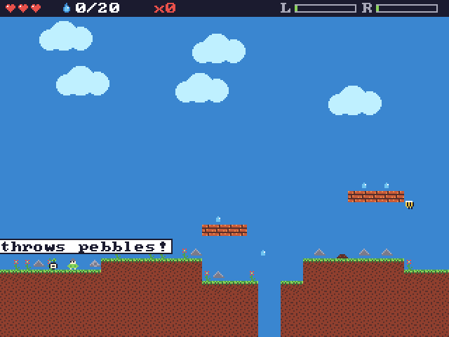

</div>

---

## ✨ Why BitKit?

- 🎮 **Plug in a controller and play.** Press Run and you're testing with a real gamepad straight away. Analog triggers come through as `press()` from 0 to 255.
- 🧠 **One runtime, two homes.** The same C code runs on PocketBit and, compiled to WebAssembly, in your browser. What you test is what ships.
- 👾 **Enemies without code.** Build entities with sprites, animations, stats and a visual behavior tree, then paint them onto the map.
- ⚡ **Fast to change.** Edit code, art or a level, press Run, and see the change right away. Everything autosaves.
- 🔓 **Open all the way down.** MIT software and open hardware. No accounts and no installs.

## 🖼️ The studio

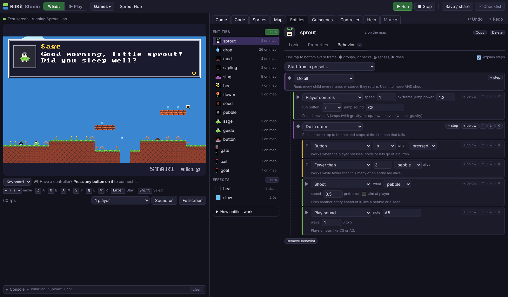

**Edit** and **Play** at the top switch between making a game and playing it on a Bit, the emulated PocketBit. Play can show two linked Bits side by side, each with its own controls, to try a game for two. **Games** has the demos and your own games, and each one keeps its own changes.

| Tab | What it does |
|---|---|
| **Game** | Sliders, switches and lists for every number a game declares with `tune()`, the player's hearts and stats, and the game checklist |
| **Code** | Lua editor with syntax highlighting, completion with a line of help for every function, find (Ctrl+F), error-line markers and a console |
| **Sprites** | 512 tiles of 8×8 pixels; pen, fill, pick, flip, rotate and tile behaviours (named chips: switch on `solid`, `water`… and ask `fget(tile, "water")`); a 256-colour palette editor |
| **Map** | 256×128 tile map with Tiles and Entities layers, paint, eraser, box and fill tools, zoom with the wheel. A ghost of your last 3 play routes shows where the player actually goes |
| **Track** | For racing games: spline road editor, items along the lap, elevation brush and the road's segment tiles |
| **Entities** | Sprites, animations, team, HP, stats, effects (heal, slow…) and a behavior tree with presets, where every step says what it does |
| **Cutscenes** | Dialog with portraits, camera pans, walks, fades and screen shake. Play them when a level starts, from a trigger zone on the map, or from code |
| **Controller** | Live view of every button, remapping, threshold and deadzone |
| **Help** | Getting started, and the full API reference with search |

Tabs a game does not use (Track for a platformer, Map for a racer) wait under **More**. Undo and redo work on every tab.

<details>
<summary>📸 More screenshots</summary>

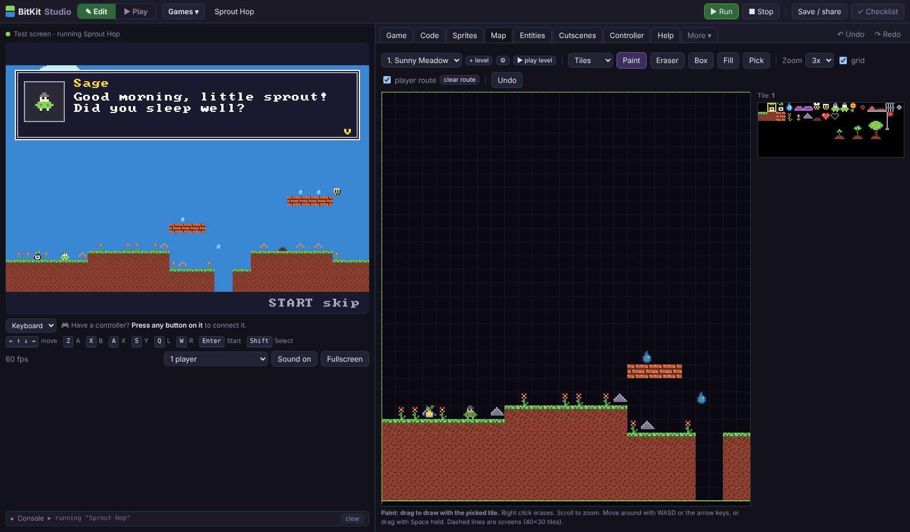

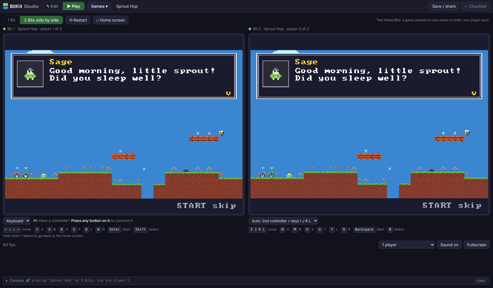

</details>

## 🚀 Quick start

1. Open **[dvrkstvr.github.io/bitkit](https://dvrkstvr.github.io/bitkit/)** in Chrome, Edge or Firefox.
2. Press **▶ Run** (or Ctrl+Enter) to play the game that is open, Sprout Hop at first. Click the game screen and use the arrow keys with Z and X, or plug in a controller and press any button on it.
3. **Games** at the top has every demo (Sprout Hop, Beacon Keeper, Sweep Storm, Kart Lab, Crossgate, Tinwing) and your own games. Each one keeps its own changes.
4. Change something and press Run again. The **Game** tab has sliders for how the game feels, the other tabs are the editors.
5. **Play** at the top shows the game on a Bit, the emulated PocketBit, with its home screen. Pick **2 Bits side by side** to try playing together. Hold Start+Select to go back to the home screen.

Want it offline? [`dist/bitkit-studio.html`](dist/bitkit-studio.html) is one self-contained file.

A cart is just three functions:

```lua
function _init()   x, y = 160, 120 end
function _update()
  if btn("left")  then x = x - 1 end
  if btn("right") then x = x + 1 end
end
function _draw()   cls(1) circfill(x, y, 4 + press("r") / 32, 9) end
```

## 📏 Game rules

Every BitKit game, built-in or from the community, has a **main menu**, **one level you can play from start to end**, **quick resume** (Continue goes straight back into play or to your checkpoint), a **pause menu with settings** such as the volume, and **a clear goal**. One call gives your game all the menus:

```lua
function _init()
  game{title = "my game", goal = "Catch 10 stars.", continue = function(cp) score = cp.score end}
  -- ... call checkpoint({score = score}) as you go, and game_win("You did it!") at the end
end
```

The studio's **Checklist** button checks your game. Read the details in **[GAME_RULES.md](GAME_RULES.md)**.

## 🌱 The demos

Open **Games** in the studio to pick one.

### Sprout Hop

A small platformer that shows off most of the engine:

- Analog run on **R** and pebbles on **B**. Stomp slugs and bees.
- Water drops heal you. Mud and sticky seeds slow you down.
- Stand next to a **sapling** while it grows and fight off the bees it attracts. Once it's a tree, it's your checkpoint.
- Talking NPCs, and a pressure button that opens a gate.
- Two levels, with cutscenes when each one starts and when you reach the gate.
- **Goal:** reach the red flag at the end of Mossy Cave. Continue picks up at your last tree.
- Two players: pick **2 players** under the screen (player 2 is the blue sprout), or press **＋ Add a Bit** to play from several linked windows (up to 8 players).

### Beacon Keeper

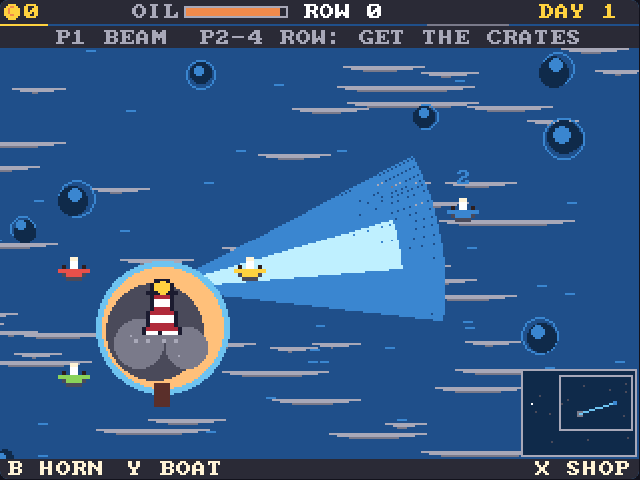

An idle game for 1 to 4 players. Player 1 is the lighthouse in the middle of a sea bigger than the screen. Everything is drawn from code, without a map or entities.

- Ships can't see the rocks. Aim your beam at them and they steer around the rocks into the harbour.
- Squeeze **R** for a brighter beam that burns lamp oil. Squeeze **L** for a narrow, long spotlight. **B** sounds the foghorn.
- Each day brings a sea haze that hides the rocks and shortens the beam. At night, pirates hunt the merchant ships, so keep your light on them until they flee.
- Docked ships pay tolls. Spend them in the harbour shop (**X**) on oil, a better lens, ship lanterns, coast cannons, a bigger harbour, and a clockwork lens that aims the beam for you.
- Players 2 to 4 row little boats (player 1 can hop into one with **Y**). They pick up the crates floating in the water, including the ones wrecks and sunk pirates drop, and bring them to the island. If a boat hits a rock, it spills its cargo.
- With one player it uses `save()`, `saved()` and `clock()`, so the harbour keeps earning while the Bit is off.
- **Goal:** guide 100 ships safely home (the harbour keeps going after that).

### Sweep Storm

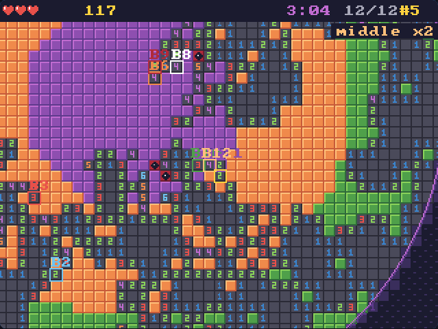

A minesweeper battle royale for up to 20 Bits, with bots filling the empty spots.

- One big round island, made from a seed the Bits share, so every match is a new map. Everyone digs at the same time.
- The shore is easy and worth 1 point a cell. The middle ring has more mines and is worth 2; the core is packed with mines and worth 4.
- Power-ups hide under the cells and get stronger towards the middle: Shield and Scan on the shore, Heart and Sonar in the middle, Blast and Freeze (stuns every other digger) in the core.
- Walk over dug ground with the D-pad, **A** digs, **B** flags, **X** uses your power-up and holding **Y** shows the whole island.
- A mine costs one of your 3 hearts and stuns you. After 40 seconds a storm closes in from the shore and standing in it costs hearts too.
- **Goal:** have the most points when the storm closes or the time runs out (the last digger standing gets a bonus).
- **Play together:** open more studio windows, load Sweep Storm in each and pick New game. They find each other in the lobby and any of them can start. This uses network events (`net_send` / `net_recv`), not lockstep, so it scales to 20 PocketBits over ESP-NOW. Play alone and Continue takes you back to the match.

### Crossgate

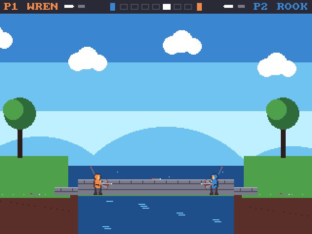

A tug-of-war crossbow duel. Wren (orange) fights east out of the Sea Gate, Rook (blue) fights west out of the Mill Gate, through seven rooms of a little town.

- **X** shoots, **A** jumps, hold **down** to crouch. Bolts drop as they fly and nothing blocks them: jump over low ones, crouch under high ones (from far away, a dropping bolt still hits a crouching rival).
- Walk into your rival with a bolt loaded to stab them. If you both walk in loaded at the same height, the bolts clash and push you both back.
- You hold one bolt loaded and one spare. Bolts that miss, or fall from the fallen, lie on the ground: walk over them to pick them up.
- Win a fight and you get the way: run for your gate. Your rival walks back in from the far side of the screen.
- One player fights the Rook (CPU, Easy / Normal / Hard in Settings). Two players share one screen or play on linked Bits. With more players, the winner stays on and the loser goes to the back of the queue.
- **Goal:** get out through your gate before your rival gets out of theirs.

### Tinwing (2.5D)

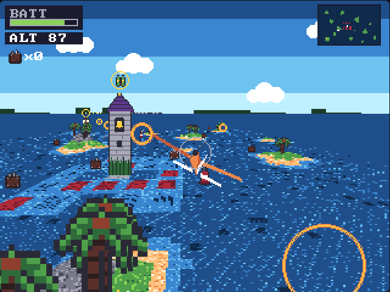

A story game drawn in 2.5D like Kart Lab. Perch is a town on stilts, on a planet that is nearly all sea: letters go by pigeon and people go by boat. You play Pip, a teenager who builds radio-controlled planes.

- **Town:** walk the boardwalks in a tilted diorama view (`floor()` plus scaled sprites). Talk to Mags at the pigeon post and Tobin the ferryman with **A**, and use your workbench by the shed.
- **Workbench:** build the plane from wings (Kite, Swift, Albatross), a motor (Hummer, Buzzer), a battery and a paint job. The plane is a little 3D model drawn from triangles, so you see it turn on the stand. Scrap from crates buys new parts.
- **Flying:** a chase camera over the sea and the islands (`floorh()`). Left and right turn, up and down climb and dive (swap them in Settings). Hold **A** or squeeze **R** to run the motor; let go and you glide, which costs no battery. Warm air rings give a Tailwind (an effect on the Entities tab). Fly low over the yellow pad at Perch to land. If the battery goes flat you splash down and Tobin fishes you out.
- **The story so far:** a squall knocked the mail satchel out of the sky past the Drowned Belltower. Your first battery can't reach it, but there's a Twin Cell on top of the Belltower. Fit it and fly out to the reef.
- **Goal:** find the mail satchel and fly it home to Perch. Continue puts you back in town with everything you found.
- Both maps are levels (Perch and The Shallows), and every house, crate, ring and person is an entity you can move on the Map tab. The story is on the Cutscenes tab.

## 🏎️ The demo: Kart Lab (2.5D)

A kart racer drawn SNES-style: the map becomes a floor seen in perspective, with real hills, and karts, trees and items are scaled sprites.

- **It's all about the karts.** In the garage, pick a body (Dart, Brick, Hopper), an engine (Buzz 2-stroke, Twin, V-Torque), tyres (Slicks, Knobbly, Softs) and a paint job. Every part changes speed, accel, grip, weight, offroad and drift.
- **Analog throttle** on R: squeeze harder to go faster. B brakes. Steering comes in 3 stages that blend as you hold a direction: a tap nudges, a hold turns, a long hold turns hard.
- **Drift** with L (or B while on the throttle). The sparks go white, amber, then violet; let go for a boost. Full lock into a drift turns just a bit tighter than normal steering, and steering against it opens the line up.
- **Items** from crates, used with X: Nitro, Oil Slick, Bolt, Drone (chases the kart in front) and Shield. Rivals use them too. Hold down to look back, and hold down while using a Bolt or Drone to fire it backwards.
- **Race your friends** in the same match: pick **2 players** for split screen (up to 4 with controllers), or **＋ Add a Bit** for linked Bits, each showing its own kart (up to 8). Everyone builds their own kart in the garage, player 1 picks the track, and rivals fill the grid up to 8 karts (`KARTS` at the top of the code).
- **Hills and jumps**: the ground rises and falls, and fast karts leave the ground over crests.
- **Goal:** finish 1st on every track. Continue drops you straight into a race with your saved kart; Rivals (Easy, Normal, Hard) is in the pause menu's Settings.
- **Tracks are made on the Track tab.** The road is a smooth loop: drag its points, double-click the road to add one, and place boost pads, crate rows, hills, bumps, dips and ramps along it. Click a point to give it its own road and kerb width (the road blends to the next point). Hills, bumps, dips and ramps have height and size sliders and a shape curve you drag, with presets (round, dome, cone, flat top, spike, straight, kicker). Paint elevation with the height brush (raise, lower, flatten, smooth), set the road width, kerbs and laps, and press **▶ race it**. The road is built from a few segment tiles you paint right there (road, kerb A/B, grass, start line, boost pad); the edge tiles where they meet are generated. Two tracks are included: Pinewood Loop and Quarry Hills.

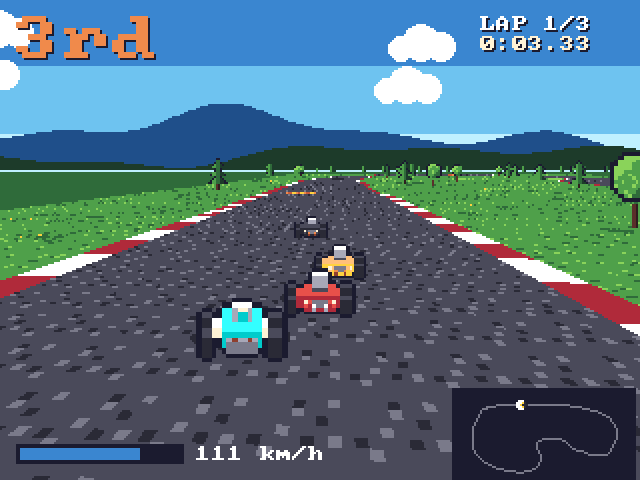 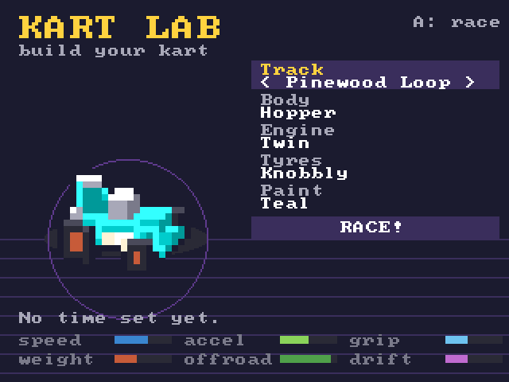
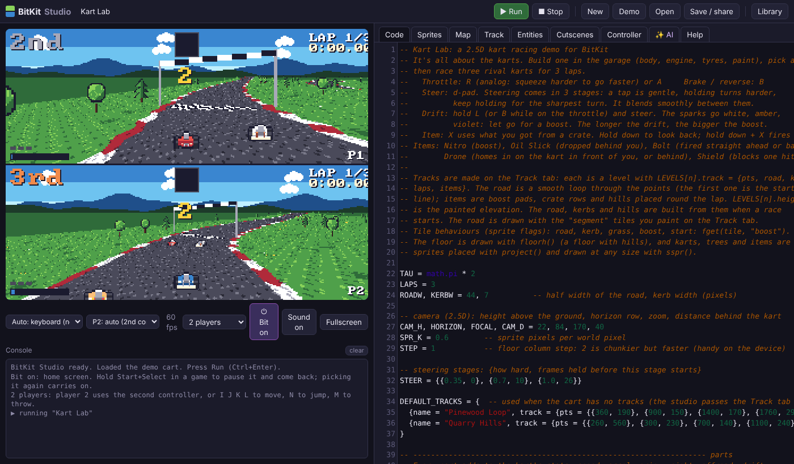

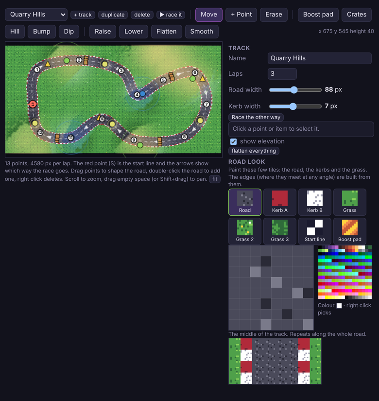

## 🕹️ Controls

| PocketBit | Gamepad (standard mapping) | Keyboard |
|---|---|---|
| D-pad | D-pad or left stick | Arrow keys |
| A / B / X / Y | South / East / West / North | Z / X / A / S |
| L / R | LB+LT / RB+RT (analog) | Q / W |
| Start / Select | Start / Back | Enter / Shift |

## 📚 Lua API at a glance

| Area | Functions |
|---|---|
| Callbacks | `_init` `_update` `_draw` |
| Game shell | `game{}` `checkpoint` `game_win` `setting` `mus` `game_play` `GAME.state` (title screen, pause menu, settings: see [GAME_RULES.md](GAME_RULES.md)) |
| Graphics | `cls pset pget line rect rectfill circ circfill text spr map camera clip pal palt palette shade` |
| Tunables | `tune(name, default, min, max)` (a slider on the studio's Game tab, saved with the game) |
| Map | `mget mset fget fset` |
| 2.5D | `floor floorh hset hget depth project sspr` (perspective floor from the map, hills, world-to-screen, scaled sprites) |
| Input | `btn btnp btnr press` |
| Sound | `sfx tone stop` (8-voice stereo synth) |
| Entities | `ents_update ents_draw ents_player ents_spawn ents_all ents_touch ents_kill ents_damage ents_on` |
| Stats & effects | `stat stat_set fx_apply fx_has fx_remove fx_clear` |
| Sensors & events | `raycast circlecast on emit` |
| Levels & cutscenes | `level LEVEL LEVELS cutscene cutscene_playing` |
| Multiplayer | `btn(b, p) press(b, p) PLAYERS ME ents_players ents_player_pal` (lockstep, 2-4 Bits) |
| Network events | `net_send net_recv NET_ID` (big games, up to 20 Bits over ESP-NOW) |
| Save data | `save saved clock` |
| Misc | `t time rnd srand print` |

The full reference is in the studio's **Help** tab.

## 🧩 Specs

| | |
|---|---|
| Screen | 320×240, 256-colour palette |
| Graphics | 512 tiles of 8×8, 256×128 map |
| Input | 12 buttons, analog pressure 0–255 |
| Audio | 8 voices, 6 waveforms, stereo |
| Scripting | Lua 5.4 in a sandbox with a per-frame instruction budget |
| Target | 60 fps locked |

## 🛠️ Build from source

Needs [Emscripten](https://emscripten.org/docs/getting_started/downloads.html) and Node.

```sh
./build.sh                                     # -> studio/runtime.js (WASM inlined)
node tools/ci.cjs                              # runtime checks + 3000 frames of the demo
python3 tools/bundle.py dist/bitkit-studio.html
cd studio && python3 -m http.server 8000       # dev server
```

```
runtime/        C core shared by device and web (bk.h, bk_core.c, bk_lua.c, bk_entities.lua)
platform/web/   Emscripten host glue
studio/         Browser studio (plain HTML/JS, no build step)
third_party/    Lua 5.4.7
tools/          bundler and tests
docs/media/     README images
```

## 🗺️ Roadmap

- [x] C + Lua runtime in WebAssembly
- [x] Studio: code, sprites, map, controller
- [x] Entity maker with behavior trees, sensors and events
- [x] Stats, effects and checkpoints
- [x] Player route overlay in the map editor
- [x] Levels and cutscenes
- [x] Multiplayer in the studio: two players on one screen, or up to 8 linked Bit windows in lockstep (home-screen lobby, pause together, rejoin after a reload)
- [ ] Music tracker and SFX editor
- [ ] Animation timeline editor
- [ ] ESP32-S3 host (PocketBit firmware)
- [ ] Local multiplayer over ESP-NOW
- [ ] Launcher, save states and utility apps

## 🤝 Contributing

Ideas, bug reports and pull requests are welcome. See [CONTRIBUTING.md](CONTRIBUTING.md).

## 📄 Credits and licences

MIT (see [LICENSE](LICENSE)). Lua 5.4 (MIT, PUC-Rio). CodeMirror 5 (MIT). 8×8 font: font8x8 by Daniel Hepper (public domain).
Inspired by fantasy consoles such as TIC-80 and PICO-8. No code is copied from GPL projects.

<div align="center"><sub>Made for tinkerers who want to hold their games in their hands.</sub></div>
